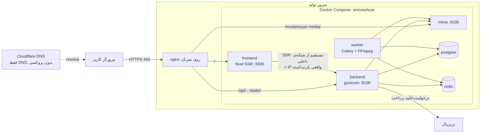
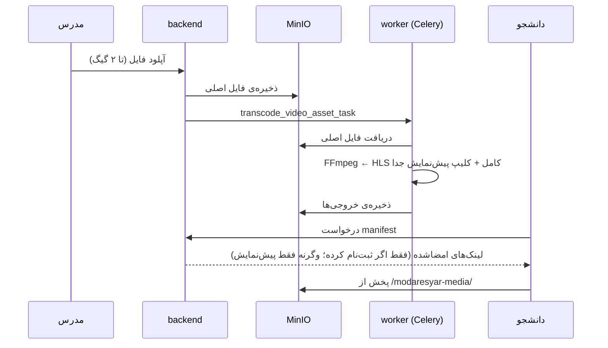

# معماری آموزش‌یار

این سند تصویر کامل سیستم است: اجزای نرم‌افزار، نحوه‌ی ارتباطشان، و اینکه نسخه‌ی تولید (production) روی سرور چطور اجرا و نگهداری می‌شود. تصمیم‌های جزئی‌تر در [`docs/adr/`](adr/) ثبت شده‌اند.

---

## ۱. نمای کلی

آموزش‌یار یک پلتفرم آموزش آنلاین «تک‌مدرس» است: هر نصب (هر سایت) متعلق به یک مدرس است که دوره، ویدیو و آزمون منتشر می‌کند و دانشجو ثبت‌نام، خرید و یادگیری می‌کند. برند پیش‌فرض «مدرس‌یار» است.

| لایه | فناوری |
|---|---|
| فرانت‌اند | Nuxt 3 (SSR برای سئو)، Vue 3، Pinia، Tailwind |
| API | Django 5.1 + Django REST Framework، احراز هویت JWT (SimpleJWT) |
| کار پس‌زمینه | Celery با Redis به‌عنوان broker |
| پردازش ویدیو | FFmpeg ← خروجی HLS |
| دیتابیس | PostgreSQL 16 |
| فایل‌ها | MinIO (سازگار با S3) از طریق django-storages |
| پرداخت | زرین‌پال |
| وب‌سرور | nginx روی میزبان + Let's Encrypt |

---

## ۲. نمودار اجزا



نکته‌ها:

- **همه‌چیز روی یک دامنه است** (`modaresyar-org.site`)، پس مرورگر به CORS نیاز ندارد.
- پورت سرویس‌های Docker فقط روی `127.0.0.1` باز است. از بیرون فقط nginx (۸۰/۴۴۳) و SSH (۲۲) در دسترس است.
- Cloudflare فقط DNS است (ابر خاکستری). پروکسی عمداً خاموش است: کاربران ایرانی‌اند، آپلود ویدیو تا ۲ گیگ است (پلن رایگان Cloudflare سقف ۱۰۰ مگ دارد) و certbot مستقیم به سرور نیاز دارد.

---

## ۳. مسیریابی درخواست‌ها (nginx)

| مسیر | مقصد | ملاحظات |
|---|---|---|
| `/api/v1/auth/` | backend | محدودیت نرخ ۵ درخواست/ثانیه برای هر IP (burst ۱۰) |
| `/api/v1/videos/upload/` | backend | بدنه تا ۲ گیگ، بدون بافر، timeout ده دقیقه |
| `/api/` | backend | محدودیت نرخ ۵۰ درخواست/ثانیه (burst ۱۰۰)، بدنه تا ۵۱۲ مگ |
| `/static/` | backend | فایل‌های استاتیک جنگو (whitenoise) |
| `/modaresyar-media/` | MinIO | لینک‌های امضاشده‌ی S3؛ هدر Host دست‌نخورده می‌ماند چون جزو امضاست |
| `/` | frontend | هدرهای امنیتی (HSTS، X-Frame-Options، nosniff، Referrer-Policy، Permissions-Policy) |
| `/api/docs/`، `/api/schema/` | backend | در prod فقط برای staff (حساب توسعه‌دهنده)؛ بقیه 401 می‌گیرند |
| `www.` و `http://` | ریدایرکت ۳۰۱ | همه به `https://modaresyar-org.site` |
| `/admin/` جنگو | **باز نیست** | فقط از طریق تونل SSH (بخش ۸) |

> `/admin/` که در مرورگر باز می‌شود صفحه‌ی پنل مدیریت خود Nuxt است، نه ادمین جنگو.

فایل مرجع: [`deploy/nginx.conf`](../deploy/nginx.conf). نسخه‌ی روی سرور (`/etc/nginx/sites-available/amozeshyar`) همین فایل است به‌اضافه‌ی خطوط SSL که certbot اضافه کرده.

---

## ۴. بک‌اند (Django)

اپ‌ها در `backend/apps/`:

| اپ | مسئولیت |
|---|---|
| `common` | ابزارهای مشترک: صفحه‌بندی، اعتبارسنجی فایل، مدیریت خطا |
| `accounts` | کاربران، ورود/ثبت‌نام، JWT، پازل امنیتی (captcha) |
| `instructors` | پروفایل مدرس و تنظیمات ظاهری سایت (صاحب سایت = `is_site_owner`) |
| `courses` | دوره‌ها، فصل‌ها، درس‌ها، فایل‌های دوره (تا ۵۰۰ مگ) |
| `videos` | آپلود ویدیو، ترنسکد HLS، پیش‌نمایش رایگان، manifest امضاشده |
| `enrollments` | ثبت‌نام دانشجو در دوره و کنترل دسترسی |
| `payments` | پرداخت زرین‌پال و callback |
| `messaging` | پیام‌رسان کلاس (متن، عکس، ویس، فایل)، ری‌اکشن، پیام‌های ربات |
| `board` | تابلوی اعلانات |
| `exams` | آزمون‌ها به سبک Quera؛ ربات پیام‌رسان نمره و راهنمایی می‌فرستد |

همه‌ی endpointها زیر `/api/v1/` هستند. مستندات زنده‌ی API در `/api/docs/` (Swagger) و `/api/redoc/` است؛ در محیط تولید فقط حساب staff می‌تواند آن‌ها را ببیند، چون نقشه‌ی کامل API برای مهاجم مفید است.

### احراز هویت
JWT با SimpleJWT: توکن دسترسی ۱۵ دقیقه‌ای، refresh با blacklist. جزئیات در [ADR 0002](adr/0002-jwt-cookie-auth.md). ورود با پازل امنیتی محافظت می‌شود.

### محدودیت درخواست (throttle)
DRF برای هر IP/کاربر سقف دارد (`anon` ۱۰۰/ساعت، `user` ۱۰۰۰/ساعت، `auth` ۱۰/دقیقه روی ورود و ثبت‌نام، …). در prod `NUM_PROXIES = 1` است تا IP واقعی از آخرین مقدار `X-Forwarded-For` (که nginx می‌گذارد) خوانده شود و کاربر نتواند با جعل این هدر محدودیت را دور بزند.

### کش
در prod کش جنگو روی Redis (دیتابیس ۱) است. این ضروری است، نه بهینه‌سازی: پازل امنیتی ورود و شمارنده‌های throttle در کش‌اند، و با کش پیش‌فرض (حافظه‌ی هر پروسه) پازلی که در یک worker گانیکورن ساخته شده در worker دیگر شناخته نمی‌شد و شمارش تلاش‌ها بین پروسه‌ها پخش می‌شد. Redis با سیاست `volatile-lru` اجرا می‌شود تا در کمبود حافظه فقط کلیدهای موقت کش پاک شوند، نه صف کارهای Celery.

### تنظیمات
- `config/settings/base.py` مشترک، `dev.py` محلی، `test.py` تست، `prod.py` تولید.
- prod: `DEBUG=False`، کوکی‌های Secure، HSTS، ریدایرکت SSL، و `SECURE_PROXY_SSL_HEADER` (چون TLS در nginx تمام می‌شود).

---

## ۵. خط پردازش ویدیو



- پیش‌نمایش یک **فایل فیزیکی جدا** است، نه محدودیت زمانی سمت مرورگر ([ADR 0003](adr/0003-video-preview-gating.md)).
- worker با `--concurrency 1` اجرا می‌شود: در هر لحظه فقط یک ویدیو ترنسکد می‌شود چون FFmpeg سنگین‌ترین بار سرور است.
- `STORAGE_ENDPOINT_URL` عمداً آدرس عمومی سایت است تا لینک‌های امضاشده برای همان دامنه ساخته شوند.

---

## ۶. فرانت‌اند (Nuxt)

- رندر سمت سرور برای سئو ([ADR 0001](adr/0001-nuxt-for-seo.md))، با sitemap و robots.
- **درخواست‌های SSR به API مستقیم از شبکه‌ی داخلی Docker می‌روند** (`NUXT_API_BASE_SERVER=http://backend:8000/api/v1`) و IP بازدیدکننده را از هدر `X-Real-IP` (که nginx از اتصال TCP می‌گذارد و قابل جعل نیست) در `X-Forwarded-For` می‌فرستند؛ `X-Forwarded-Host` هم نام دامنه را می‌رساند (`USE_X_FORWARDED_HOST` در prod). بدون این، همه‌ی بازدیدکننده‌ها در throttle یک IP (کانتینر frontend) حساب می‌شدند و بعد از حدود ۱۰۰ بازدید در ساعت سایت برای همه خطای 429 می‌داد. منطق در `frontend/composables/useApi.ts` است.
- صفحات اصلی در `frontend/pages/`: `index`، `courses`، `classroom`، `dashboard`، `admin`، `auth`، `profile`.
- تنظیمات زمان اجرا از env می‌آید: `NUXT_PUBLIC_API_BASE`، `NUXT_PUBLIC_SITE_URL` و (فقط سمت سرور) `NUXT_API_BASE_SERVER`.

---

## ۷. استقرار تولید

### سرور
یک VPS اختصاصی در ایران: Ubuntu 26.04، ۲ vCPU، ۲ گیگ رم + ۲ گیگ swap، ۵۰ گیگ دیسک، منطقه‌ی زمانی تهران.
سایت معرفی مدرس‌یار روی سرور جداگانه‌ای است و آموزش‌یار نباید روی آن اجرا شود.
آدرس سرور و دسترسی‌ها در این مخزن (که عمومی است) نوشته نمی‌شود.

### دامنه و DNS
- قفل انتقال و حریم خصوصی WHOIS فعال است.
- Nameserver روی Cloudflare؛ رکوردهای A برای `@` و `www` به IP سرور، در حالت DNS only.

### چیدمان روی سرور
```
/srv/amozeshyar/                 کد (بدون .git؛ از روی لپ‌تاپ با git archive منتقل می‌شود)
/srv/amozeshyar/deploy/.env      رازها — فقط root (600)، داخل git نیست
/etc/nginx/sites-available/amozeshyar
/etc/letsencrypt/live/modaresyar-org.site/
/usr/local/bin/amozeshyar-backup + /etc/cron.d/amozeshyar-backup
/var/backups/amozeshyar/{db,media}
```

سرویس‌ها و سقف رم ([`deploy/docker-compose.prod.yml`](../deploy/docker-compose.prod.yml)):

| سرویس | سقف رم | توضیح |
|---|---|---|
| postgres | 256m | volume `amozeshyar_postgres-data` |
| redis | 96m | صف Celery (db 0) + کش جنگو (db 1)؛ `volatile-lru`، بدون ذخیره روی دیسک |
| minio | 384m | volume `amozeshyar_minio-data`، نسخه‌ی ثابت `RELEASE.2025-09-07T16-13-09Z` |
| backend | 448m | gunicorn، ۲ worker × ۲ thread |
| worker | 768m | Celery + FFmpeg؛ از همان ایمیج backend |
| frontend | 256m | Nuxt |

---

## ۸. امنیت

| لایه | تدبیر |
|---|---|
| SSH | فقط کلید؛ ورود با رمز خاموش؛ `MaxAuthTries 3` (`/etc/ssh/sshd_config.d/00-hardening.conf`) |
| فایروال | ufw: فقط ۲۲، ۸۰، ۴۴۳ |
| brute-force | fail2ban روی sshd (۵ تلاش در ۱۰ دقیقه ← یک ساعت مسدود) |
| به‌روزرسانی | unattended-upgrades برای وصله‌های امنیتی |
| TLS | Let's Encrypt، تمدید خودکار با `certbot.timer` |
| HTTP | هدرهای امنیتی، `server_tokens off`، محدودیت نرخ nginx + throttle در DRF |
| اپلیکیشن | پازل امنیتی ورود، JWT کوتاه‌عمر، کوکی Secure، CSRF، `check --deploy` بدون هشدار امنیتی |
| رازها | ساخته‌شده روی خود سرور با `openssl rand`؛ فقط در `.env` با دسترسی root |
| Docker | پورت‌ها فقط روی localhost؛ لاگ محدود (۳ × ۱۰ مگ)؛ میرور آروان |

**دسترسی به ادمین جنگو** (عمداً از اینترنت بسته است):

```bash
ssh -L 8100:127.0.0.1:8100 root@SERVER
# سپس در مرورگر: http://localhost:8100/admin/
```

---

## ۹. بکاپ و بازیابی

- هر شب ساعت ۳:۳۰: `pg_dump` (۱۴ نسخه‌ی آخر) + کپی rsync از فایل‌های MinIO (بدون حذف، تا فایل پاک‌شده‌ی اشتباهی بماند). لاگ: `/var/log/amozeshyar-backup.log`.
- بکاپ‌ها روی همان دیسک‌اند؛ برای خرابی کامل سرور، گاهی یک کپی از `/var/backups/amozeshyar` بیرون از سرور بگیرید.

بازیابی دیتابیس:

```bash
cd /srv/amozeshyar
C="docker compose -f deploy/docker-compose.prod.yml --env-file deploy/.env"
$C stop backend worker
docker exec -i amozeshyar-postgres-1 pg_restore -U amozeshyar -d amozeshyar --clean --if-exists \
    < /var/backups/amozeshyar/db/amozeshyar_YYYY-MM-DD_HHMM.dump
$C start backend worker
```

---

## ۱۰. عملیات روزمره

همه‌ی دستورها روی سرور، از `/srv/amozeshyar`:

```bash
C="docker compose -f deploy/docker-compose.prod.yml --env-file deploy/.env"
$C ps                      # وضعیت سرویس‌ها
$C logs -f backend         # لاگ زنده (worker، frontend، …)
$C restart backend         # راه‌اندازی دوباره
docker stats --no-stream   # مصرف رم
```

**انتشار نسخه‌ی جدید** (از لپ‌تاپ، روی برنچ ادغام‌شده):

```bash
git archive --format=tar HEAD | ssh root@SERVER 'tar -x -C /srv/amozeshyar'
ssh root@SERVER 'cd /srv/amozeshyar && C="docker compose -f deploy/docker-compose.prod.yml --env-file deploy/.env" \
  && $C build && $C up -d && $C exec -T backend python manage.py migrate --noinput'
```

`git archive` فقط فایل‌های commit‌شده را می‌فرستد و `.env` سرور دست نمی‌خورد. اگر `deploy/nginx.conf` تغییر کرد، تغییر را دستی در فایل سرور اعمال کنید (خطوط certbot را نگه دارید) و `nginx -t && systemctl reload nginx`.

**صاحب سایت** (اجرای دوباره بی‌خطر است؛ رمز حساب موجود عوض نمی‌شود):

```bash
$C exec backend python manage.py setup_site --email ... --password ... --first-name ... --last-name ...
```

---

## ۱۱. تست امنیت و بار (۱۴۰۵/۰۷/۲۱)

**از بیرون:** فقط پورت‌های ۲۲/۸۰/۴۴۳ باز؛ TLS 1.0/1.1 بسته؛ `.env`، `.git`، ادمین جنگو، کنسول MinIO و لیست باکت در دسترس نیستند؛ CORS برای دامنه‌ی بیگانه هدر نمی‌دهد؛ Host جعلی به دامنه‌ی اصلی ریدایرکت می‌شود؛ از ۸۳ مسیر API فقط ۴ مسیر عمداً عمومی بدون ورود جواب می‌دهند؛ ورود بعد از ۱۰ تلاش در دقیقه 429 می‌دهد، حتی با `X-Forwarded-For` جعلی.

**داخل سرور:** ورود SSH با رمز خاموش، تنها کلید مجاز کلید لپ‌تاپ توسعه، پورت‌های Docker فقط روی localhost، backend/worker/frontend با کاربر غیر root، `.env` و بکاپ‌ها با دسترسی فقط root.

**بار:** ۲۰۰ کاربر هم‌زمان با IPهای مختلف روی API ← ۲۰۰۰ درخواست، صفر خطا، p95 حدود ۱ ثانیه؛ ۵۰ کاربر هم‌زمان روی صفحه‌ی اول (SSR کامل) ← صفر خطا، p95 حدود ۲.۳ ثانیه؛ Postgres حداکثر ۵ اتصال.

## ۱۲. کارهای باز

- زرین‌پال هنوز در حالت Sandbox است؛ با گرفتن merchant ID واقعی، `ZARINPAL_MERCHANT_ID` و `ZARINPAL_SANDBOX=False` در `.env` تنظیم و backend ری‌استارت شود.
- بکاپ خارج از سرور هنوز تنظیم نشده.
- مانیتورینگ خطا (Sentry) با `SENTRY_DSN` آماده است ولی فعال نشده.
